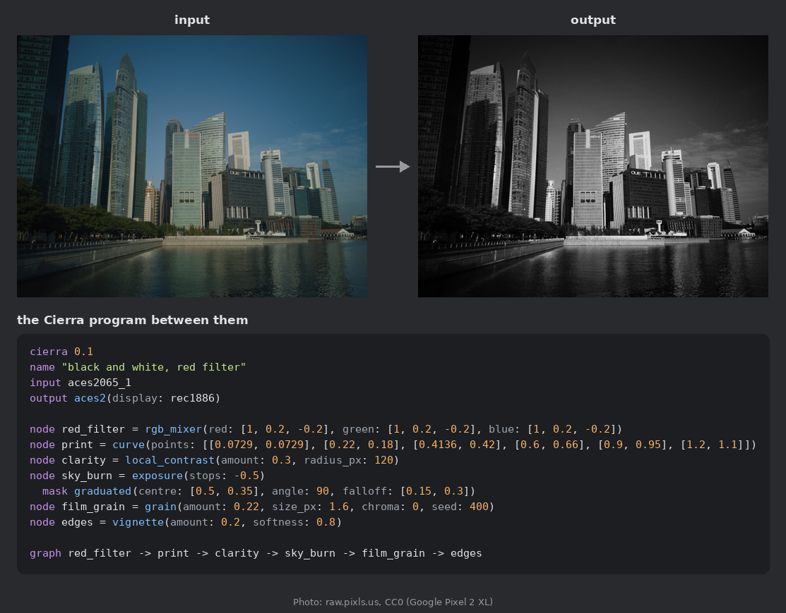

# Cierra

Cierra is a small open-source language for colour grades: a grade is a text file you can check, render and compile.



The program under the pictures is [examples/bw_red_filter.cierra](examples/bw_red_filter.cierra), comments left out.

## Install

You need Python 3.12 or later.
```
git clone https://github.com/EzulFilm/cierra && cd cierra
python3 -m venv .venv && . .venv/bin/activate
pip install -e ".[images]"        # Pillow and tifffile, for PNG / JPEG / TIFF
```

## A first grade

Save this as `hello.cierra`:
```
cierra 0.1
name "hello"
input linear_rec709
output aces2(display: srgb)
node warm = printer_lights(red: 2, blue: -2)
node pop = cdl(slope: [1.05, 1.05, 1.05], sat: 1.1)
graph warm -> pop
```

Then check it, render it on a test frame, and compile it:
```
cierra check hello.cierra                                     # prints the canonical form
mkdir -p out                                                  # render won't create the folder
cierra render hello.cierra tests/data/frames/pens.npy out/pens.png
cierra dctl hello.cierra out/hello                            # -> out/hello/hello.dctl
cierra lut hello.cierra out/hello_lut                         # -> .cube and CLF files
```

## What's in the repo

- **The language.** [docs/spec.md](docs/spec.md) is the specification, and [docs/authoring.md](docs/authoring.md)
  lists every op and mask with its parameters and defaults.
- **Examples.** [examples/](examples/) has 22 commented programs for ordinary jobs, and [looks/](looks/) has three
  longer ones.
- **A checker and a renderer.** `cierra check` reports every problem it finds, with line and column, and
  `cierra render` runs the program on an image, in NumPy on the CPU.
- **Compile targets.** DCTL, LUT (.cube and CLF), ASC CDL, ACES AMF, a CUDA kernel and a WebGPU shader, all tested
  against the renderer. When a target can't hold an op, the compiler refuses and names the node.
- **Grading from written notes.** `cierra loop` writes the program from your notes with a language model (or, by
  default, a fixed set of rules). The model sees the notes and numbers about the frame, never the pixels.
- **A web playground.** [web/playground/](web/playground/) grades a frame live in your browser, with scopes. Start it
  with `python tools/playground_server.py`, then open http://127.0.0.1:8790/.
- **Tests.** [tests/](tests/) holds the suite; `make test` runs it with no network, GPU, API key or model.

More detail on all of this is in [docs/guide.md](docs/guide.md); changes are in [CHANGELOG.md](CHANGELOG.md).

## Licence

Copyright 2026 CIERRAEZUL LLC. Apache License 2.0; see [LICENSE](LICENSE) and [NOTICE](NOTICE). "Cierra" is a
name used by CIERRAEZUL LLC and is not licensed under the Apache License. The test photos are CC0 camera RAWs from
raw.pixls.us.

ACES and AMF are specifications of the Academy of Motion Picture Arts and Sciences. Cierra is not affiliated with or
endorsed by the Academy.
