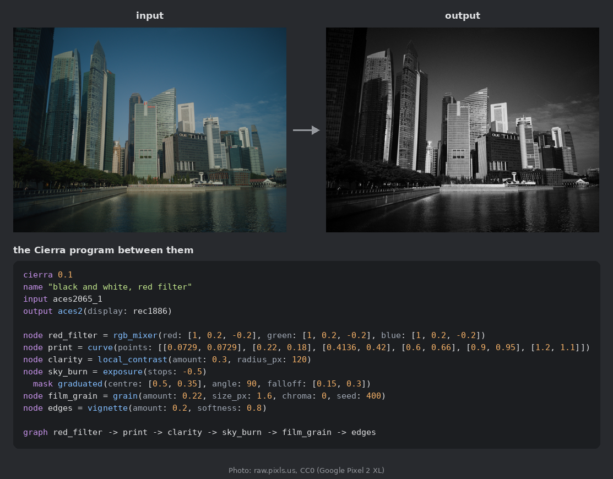
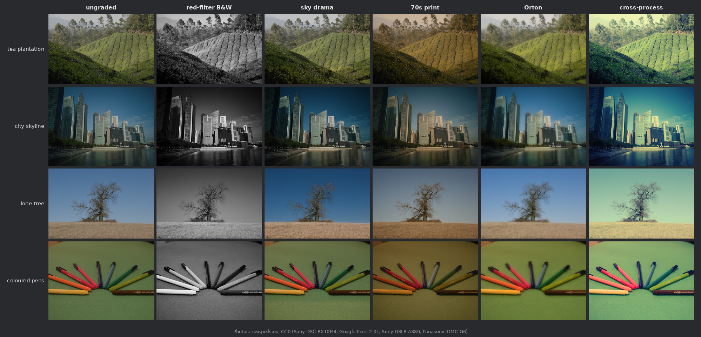

# Cierra

**Colour grades as code.** Cierra is a small language for colour grading. A grade is a short, readable program that
you can check, diff, review, version and compile to the tools you already use: DCTL, WebGPU (WGSL),
CUDA, 3D LUTs (.cube and CLF) and ASC CDL. Every target is tested against one reference engine.

It is also built for language models. Describe the grade you want ("warmer faces, keep the blacks clean") and a model
writes the program. Cierra checks it, renders it, measures whether each note actually moved the picture the right way,
and keeps every version with a diff a colourist can read. The model never sees a pixel, and nothing it writes is ever
executed.



The program under the pictures is [examples/bw_red_filter.cierra](examples/bw_red_filter.cierra) (its comment and
label lines left out): one monochrome channel mixed mostly from red, so a blue sky goes dark, then a hard print curve,
darkroom clarity, the sky burned in, grain and a vignette. Cierra's own engine renders all of it; a target that
cannot express an op refuses the program and says why (here `local_contrast` is spatial, beyond a LUT or a shader;
grain and the vignette depend on position, beyond a LUT), or `--split` cuts the graph around it.



Each column is one short program from the [examples](examples/): [red-filter B&W](examples/bw_red_filter.cierra),
[sky drama](examples/sky_drama.cierra), [70s print](examples/warm_70s_print.cierra),
[Orton](examples/orton_landscape.cierra) and [cross-process](examples/cross_process_video.cierra). Photos: camera RAWs
from raw.pixls.us, CC0. Regenerate with `python tools/make_readme_figures.py` (it downloads the four RAW files, pinned
by SHA-256, and needs rawpy: `pip install -e ".[raw]"`).

## Why

- **A grade you can read.** Nodes, masks and a graph, in plain text. No opaque project file and no binary LUT as the
  source of truth. A change of look is a diff in a pull request.
- **Checked before it runs.** Types, units and ranges for every parameter; size, nesting and reference limits for every
  program. A program that passes the checker is safe to render, whoever wrote it.
- **One grade, many targets, measured.** The NumPy reference engine is the source of truth, and each compiler is
  tested against it. A target that cannot express an op refuses it with a reason; it never approximates silently.

  | target | worst-frame error on the example looks (ΔE00) |
  |---|---|
  | DCTL (run through a CPU harness) | max 0.0013 |
  | 3D LUT, .cube / CLF (65³, tetrahedral) | max 0.48, mean ≤ 0.06 |
  | WGSL (WebGPU) | the same per-op parity tests as DCTL; they run where wgpu finds an adapter (skipped in CI) |
  | CUDA C++ kernel (run through a CPU harness, g++) | max 0.0013 (not yet run on a GPU: an nvcc runner is included) |

  A ΔE00 of about 1 is roughly the smallest visible difference. Full numbers: [docs/targets.json](docs/targets.json).
- **LLM-native, not LLM-dependent.** The model gets the language reference, the notes and numbers measured on a
  preview, never pixels. It answers with a program in the language, and the checker treats that like any other input.
  With a local model, replies are constrained by a grammar generated from the op table, so names and value shapes are
  always valid. A deterministic rules driver and a numeric tuner work with no model at all.
- **Notes become measurements.** "Cooler", "less colour" and "keep the highlights soft" each turn into a check on the
  frame: right way, no change, or wrong way, and which node caused it. A damage gate checks every version for
  clipping, crushed or milky blacks and posterisation: a damaged version is kept but marked for a human, it can never
  end the loop as done, and a clean version is always preferred.
- **Camera to deliverable.** Camera log inputs (ARRI LogC3 / LogC4, Sony S-Log3, Panasonic V-Log, Canon Log, RED
  Log3G10, Blackmagic Film Gen 5, Apple Log, DJI D-Log) and ACES 2.0 outputs for SDR Rec.709, P3 and HDR (PQ 1000 to
  4000 nits, HLG), all through OpenColorIO.
- **Open formats only.** ACES 2.0 output through OpenColorIO, ASC CDL, CLF, .cube, DCTL, WGSL.

## Quick start

You need Python 3.12 or later (with `venv`; on Debian / Ubuntu the `python3-venv` package) and `make`. A C / C++
compiler (gcc, g++) is optional: without it the DCTL / CUDA parity tests skip.

```
git clone https://github.com/EzulFilm/cierra && cd cierra
make setup                        # .venv with pinned dependencies
make test                         # the whole suite (a few minutes): no network, GPU, key or model needed
make build                        # compile the example looks to DCTL, WGSL, CUDA, LUT and CDL where each allows
```

Or `pip install -e ".[images]"` (add `llm` for the Anthropic driver), then:

```
cierra check looks/cinematic_modern.cierra                  # check, print the canonical form
cierra render looks/cinematic_modern.cierra tests/data/frames/crowd.npy out.png   # reference engine
cierra dctl looks/cinematic_modern.cierra out/dctl          # DCTL (--split cuts around spatial ops)
cierra wgsl looks/cinematic_modern.cierra out/wgsl          # WebGPU shader
cierra cuda looks/cinematic_modern.cierra out/cuda          # CUDA C++ kernel (.cu)
cierra lut looks/cinematic_modern.cierra out/lut            # .cube and CLF
cierra cdl looks/cinematic_modern.cierra out/cdl            # ASC CDL, when the program is one
cierra fit image.npy reference.npy fitted.cierra            # fit a program to a reference grade
```

### On an NVIDIA GPU

`pip install -e ".[cuda]"` adds CuPy, and the reference engine then runs on the GPU: `cierra --device gpu render ...`,
or `CIERRA_DEVICE=gpu` for every render, fit, tuner and loop step. It is the same float64 code as on the CPU (every op,
mask and blur), and the tests compare the two: equal within 1e-9 in ACEScct, identical display values. The camera
input and ACES 2.0 output transforms stay on the CPU (OpenColorIO), split across `CIERRA_OCIO_THREADS` threads
(default 4). A 1920x1080 S-Log3 frame through an 11-node grade with glow and guided detail (RTX 3070 Laptop):

| | before | CPU now | GPU |
|---|---|---|---|
| whole render | 14.9 s | 7.4 s | 0.7 s |
| the grade alone | about 12 s | | 0.2 s |

Measure your own with `python tools/gpu_bench.py program.cierra`. CuPy brings NVIDIA's CUDA runtime libraries from
PyPI, under NVIDIA's licence; none of it ships with Cierra.

## From camera RAW to a movie

```
pip install -e ".[raw]"           # LibRaw through rawpy; FFmpeg must be installed separately
make pipeline-demo
```

This downloads a CC0 camera RAW still from [raw.pixls.us](https://raw.pixls.us/) (pinned by its SHA-256) and decodes
it to scene-linear ACES2065-1. It then runs [examples/tungsten_fix.cierra](examples/tungsten_fix.cierra) frame by
frame, so the keyframed white balance takes the tungsten orange out over the clip, and writes a ProRes-compatible
movie (FFmpeg's `prores_ks`) plus before / after stills to `out/pipeline/`. With your own files:

```
python tools/raw_to_video.py my_look.cierra shot_*.dng --out shot.mov            # one RAW file per frame
python tools/raw_to_video.py my_look.cierra still.dng --frames 96 --codec h264   # hold a still, animate the grade
```

Stills formats that LibRaw reads (DNG, CR2 / CR3, NEF, ARW, RAF, ...) work. Cinema RAW formats need their vendors'
SDKs: convert them to DNG or EXR first.

## From and to a grading application

Cierra talks to a grading application through its scripting API with a few fixed scripts that take their data as
JSON (`cierra/hosts/grading_app.py`). Nothing a model writes is run in the application.

**From the application.** The API can read, per node of a clip, its label, the names of the tools it uses and the
LUT or DCTL on it, and it can export the clip's whole grade as a 17, 33 or 65-point .cube. It cannot read the values
of wheels, curves, windows or qualifiers. So Cierra reads the grade back from that LUT: it fits a short program
(primary, saturation, hue and luma curves, and a keyed node when a node uses a qualifier) and reports how far the
program is from the LUT in ΔE00. Over the test frames, the programs fitted to 33-point LUTs of the example looks are
0.06 ΔE00 from the LUT on average for Cinematic Modern, and 0.36 for Beauty Modern, whose skin qualifier the fit can
only approximate.

```
cierra import-lut grade.cube imported.cierra             # --input acescct (default), acescg or linear_rec709
```

A LUT holds one colour-to-colour function. Spatial effects (blur, glow, noise reduction, grain) and windows are not
in an exported LUT, so they cannot come back. A qualifier comes back only approximately, as a keyed node.

**To the application.** A program goes on the clip node for node. Each Cierra node becomes a CDL when it is one,
otherwise its own DCTL, in a new colour version that is rolled back if any step fails. The API cannot create nodes,
so the clip must already have enough serial nodes, and the script says so if it does not. It cannot set wheels,
curves or qualifiers either, so the values travel as CDL and DCTL. Spatial nodes are refused with the reason. The
script then exports the clip's LUT, and Cierra checks it against the program.

## Grading with notes

```
cierra loop "warmer faces, a little more contrast, keep the blacks clean" tests/data/frames/crowd.npy history/
```

Each round, a driver proposes the next program. Cierra checks it, renders a preview, measures every note against the
ungraded frame, runs the damage gate, and commits the version to `history/` with a readable diff. With no model
configured, the deterministic rules driver gives:

```
+ node skin_warmth added: saturation(amount: 1.08) where skin(width: 30)
+ node contrast_up added: contrast(amount: 1.08, pivot: 0.38)
graph: none  ->  skin_warmth -> contrast_up
```

The driver comes from the environment:

| variable | values |
|---|---|
| `CIERRA_DRIVER` | `auto` (default: a local open-weight server when `CIERRA_LLM_URL` is set, else the Anthropic API when `ANTHROPIC_API_KEY` or `ANTHROPIC_AUTH_TOKEN` is set, else the offline rules driver), `openweight`, `anthropic`, `rules` |
| `CIERRA_LLM_URL` | an OpenAI-compatible server (llama.cpp, vLLM, Ollama), e.g. `http://127.0.0.1:8090/v1`; `CIERRA_MODEL` is the served name |
| `CIERRA_GRAMMAR` | default `1`: grammar-constrained replies on llama.cpp; `0` for servers that reject the field |
| `CIERRA_MODEL`, `CIERRA_EFFORT` | for the Anthropic driver: `claude-sonnet-5-5` (default), `claude-opus-5-5`, `claude-haiku-5-5`; effort `low` (default), `medium`, `high` |
| `CIERRA_LLM_TIMEOUT` | seconds per request to a local server (default 300; raise it for CPU inference) |
| `CIERRA_PROMPT`, `CIERRA_REVISE` | `short` / `full` language reference (open-weight default `short`); `0` turns off the revision turn |
| `CIERRA_BUDGET_USD` | spending cap per run (default 2.00), after which the loop finishes with the rules driver; `CIERRA_GPU_USD_PER_HOUR` prices a local server's time |

Keys come only from the environment through the official SDK, never from code, files or logs. Every round records
model, tokens, time and estimated cost.

### Run a model on your own machine

```
make llm-setup            # needs git, cmake, a C++ compiler, curl. llama.cpp (pinned, CPU build) + Qwen2.5-7B-Instruct Q4_K_M, SHA-256 checked (~4.7 GB)
make llm-start            # serves it on 127.0.0.1:8090
make eval-llm             # the held-out evaluations with it (CPU: tens of minutes)
make llm-stop
```

`MODEL=1.5b` for the smaller model. Cierra ships no weights; both models are Apache-2.0, and llama.cpp is MIT.

## Evaluation

`make eval` scores the rules driver and tuner on two held-out sets of notes × frames: one in the note-check vocabulary,
one with free-form notes such as "like a 70s print". `tools/eval_sheet.py` puts runs side by side for judging by eye,
because meeting the checks is not the same as a good grade.

## The language

- [docs/spec.md](docs/spec.md): grammar, types, units, ranges, and the maths of every op
- [docs/conformance.md](docs/conformance.md): each section of the spec and the tests that hold it
- [docs/authoring.md](docs/authoring.md): writing programs by hand or with a model
- 31 ops: exposure, white balance, printer lights, lift / gamma / gain wheels, CDL, contrast, curve, hue-vs-hue /
  sat / lum, sat-vs-sat, sat-vs-lum, lum-vs-sat, saturation, vibrance, hue rotate, RGB mixer, density (subtractive
  saturation), split tone, gamut compression, highlights / shadows, local contrast, guided detail, sharpen, blur,
  glow, halation, diffusion, grain, vignette, photo-to-scene
- 10 masks: HSL qualifier, RGB key, luma, skin, window (ellipse), box, polygon, graduated, depth, segment, combined with `and` / `or` /
  `not`, each with blur, edge-aware feather and matte clip black / white
- Layer blend modes: normal, add, multiply, screen, overlay, lighten, darken, subtract, difference
- Keyframes, parallel branches and layer blending
- Example programs in [examples/](examples/) (each one commented) and looks in [looks/](looks/)

## Repository

| path | what |
|---|---|
| `cierra/` | parser, checker, formatter, reference engine, compilers (`compile/`), grading loop, note checks, tuner, fitting, host adapter |
| `looks/` | looks; `examples/` short commented programs for common jobs |
| `docs/` | specification, conformance table, authoring profile, target report, SBOM |
| `tests/` | the suite; `tests/data` test frames (see its SOURCES.md), `tests/golden` reference outputs |
| `tools/` | evaluation, golden, documentation and SBOM tools; local model scripts |

Contributions are welcome: see [CONTRIBUTING.md](CONTRIBUTING.md). Security reports: [SECURITY.md](SECURITY.md).

## Licence

Apache License 2.0 (LICENSE); see NOTICE. The test frames and README figures are made from CC0 camera RAW photos
(raw.pixls.us) and a synthetic chart (tests/data/SOURCES.md).
