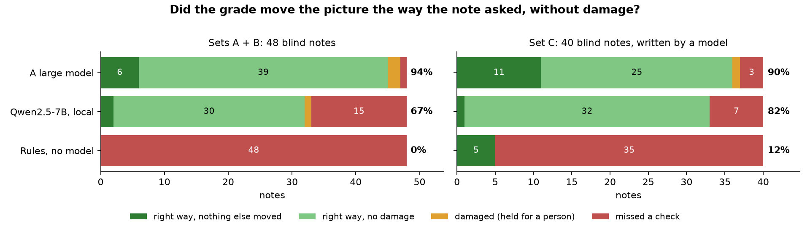

# Evaluation: grading from written notes

This note says how we measure `cierra loop`, what the numbers are, and what they don't show. The short version is in
[guide.md](guide.md#grading-from-notes); everything here can be re-run from this repository.

## The question

Given a frame and a free-form note ("make it feel like a late-autumn evening"), does the program a system writes move
the picture the way the note means, on every point, without damaging it?

We score the picture, not the program text. Anything that outputs a Cierra program can be scored: a model, a person, a
set of rules.

## Data

- **Frames.** Cierra's test frames only: five CC0 camera RAW photos from raw.pixls.us and a synthetic chart, pinned by
  SHA-256 in [tests/data/SOURCES.md](../tests/data/SOURCES.md).
- **Notes.** Two sets in this repository: set A ([heldout_freeform.json](../tests/data/heldout_freeform.json), 8 notes,
  20 checks) and set B ([heldout_freeform_b.json](../tests/data/heldout_freeform_b.json), 40 notes, 92 checks). Both
  avoid the checks' own words. Set B was written by an author who had not read the prompt, its examples or the tuner.
- **Hidden checks.** Each note carries the same request restated in a few measurable phrases, for example
  `cooler, darker` for the autumn note above. The system under test never sees them.

## What the system sees

The note and numbers about the frame (percentiles, region statistics). Never pixels. A run has two model rounds: the
model restates the note in the check vocabulary, then names the structure of the program (which ops and masks). A
deterministic tuner sets the values.

## Scoring

`tools/bench_notes.py` re-scores every run with the same code. Per note, on the reference render at 480 px against the
ungraded render:

- **Checks** (`cierra/notes.py`): a check is met when its measure moved the right way by more than its tolerance, for
  example warmth as Cr-Cb by 0.002, mid-tone luma by 0.005.
- **Damage** (`cierra/qc.py`): clipped highlights, crushed or milky blacks, posterisation and banding, each with an
  allowance over what the ungraded frame already had.
- **Side effects**: a quality no check asks about that moved visibly.

Each note gets one outcome:

| Outcome | Meaning |
|---|---|
| clean | every check met, no damage, nothing else moved |
| met | every check met, no damage, something else moved |
| damaged | every check met, but the damage gate flags the picture |
| missed | a check not met |

**SUCCESS** is the share of notes that are clean or met. Side effects are reported but don't count against SUCCESS:
a note like "1950s newsreel" should move contrast and colour together, and we have no viewing study yet to say when an
extra move is wrong. Differences between runs are paired bootstraps over notes (10 000 resamples, 95 % interval).

## Results on sets A + B (48 notes, 112 checks)

One run per system, greedy decoding for the local model, the tuner's damage guard on.

| System | SUCCESS | clean / met / damaged / missed | Checks met |
|---|---|---|---|
| Rules, no model | 0.000 (0 / 48) | 0 / 0 / 0 / 48 | 7 / 112 |
| Qwen2.5-7B-Instruct Q4_K_M, local CPU | 0.667 (32 / 48) | 2 / 30 / 1 / 15 | 94 / 112 |
| A large hosted model, through the relay driver | 0.938 (45 / 48) | 6 / 39 / 2 / 1 | 111 / 112 |

Large model minus 7B: +0.271, 95 % interval [0.146, 0.417].

The rules driver only matches words it knows, and these notes avoid them; that is what the sets are for. The 7B's
misses are mostly translation: a direction reversed or left out. The three damaged notes are ones where the note asks
for something the frame can't take without a flag (a lift on blacks that are already high, for example); those are
held for a person.



The right half of the chart is a third set of 40 notes, written by a model and kept out of this repository so it stays
usable as a blind set. It turned out easier (the notes are more literal), and on it the two models are not clearly
apart.

## The tuner's damage guard

Before the guard, about a third of the notes ended damaged for both models: the tuner pushed a value until the check
passed and went past what the frame could take. The guard (`cierra/tuner.py`, on by default,
`CIERRA_TUNER_GUARD=0` turns it off) does two things:

1. A search step that adds a damage flag the starting program didn't have is refused; the best undamaged step is kept.
2. For a flag the program started with, the node that causes it (or a pair of nodes) is eased toward neutral, and the
   change is kept only when the flag clears and no met check is lost.

Measured by replaying each model's stored work with the guard off and on (`tools/replay_tuner.py`; the model isn't
called again):

| Model | Guard | Damaged notes | Checks met | SUCCESS | Gain, 95 % interval |
|---|---|---|---|---|---|
| 7B | off | 11 | 94 / 112 | 0.458 | |
| 7B | on | 1 | 94 / 112 | 0.667 | +0.208 [0.104, 0.333] |
| Large model | off | 14 | 111 / 112 | 0.688 | |
| Large model | on | 2 | 111 / 112 | 0.938 | +0.250 [0.146, 0.375] |

No note lost a check and no note became damaged that wasn't before. The guard was built while looking at sets A and B,
so these numbers are not blind for it. On the third set, frozen before the guard ran on it, the 7B had 0 damaged notes
and the large model 1.

## The translation guide

The 7B's main failure is reading shorthand the wrong way round. The translation guide (`cierra/notes.py`, three rules,
a glossary of trade words and two more examples in the translation prompt) is on by default for local open-weight
models and off for hosted ones; `CIERRA_TRANSLATE_GUIDE=1` / `0` forces it.

We measured it on a further blind set of 40 hard notes, frozen before the run and also kept out of this repository.
The guide was written before that set existed. With the 7B, the only difference between the arms being the switch:

| | Guide off | Guide on |
|---|---|---|
| SUCCESS | 0.525 (21 / 40) | 0.750 (30 / 40) |
| Directions reversed | 9 | 4 |
| Directions missed | 22 | 12 |

On minus off: +0.225, 95 % interval [0.075, 0.400]; 11 notes fixed, 2 broken. We haven't measured the guide with a
large model, which is why it is off there.

## What these numbers don't show

- **Taste.** A check is a proxy: "warmer" is a Cr-Cb move, not a judgment that the picture looks good. The tolerances
  were set on the test frames and have not been validated with viewers.
- **Variance.** One run per system. The local model is run greedy with a fixed seed; a different CPU still changes a
  few tokens: between two machines the check totals were the same and the translations differed on a few notes.
- **Blindness.** Sets A and B are in this repository and have been used for several experiments. Treat results on them
  as development numbers. The two sets we keep private are no longer unseen by us either.
- **Reach.** Six frames, stills only, SDR, short notes in English.
- **The large model's run** went through the relay driver (a chat answering through files), not through the API
  driver, and we don't name the model here because the run can't be repeated from this repository.

## Run it yourself

```
make eval                 # the rules driver on the held-out sets; no model, no network
make llm-setup            # pinned llama.cpp build and Qwen2.5-7B-Instruct Q4_K_M, hash-checked
make llm-start
python tools/eval_heldout.py --set freeform   --mode tuner --driver openweight --label a
python tools/eval_heldout.py --set freeform_b --mode tuner --driver openweight --label b
make llm-stop
python tools/bench_notes.py --run 7b=out/evals/<stamp>_a/results.json,out/evals/<stamp>_b/results.json
```

`tools/replay_tuner.py` replays a finished run with the guard off and on, and `tools/freeze_set.py` freezes a note set
of your own by hash before you run anything on it.
