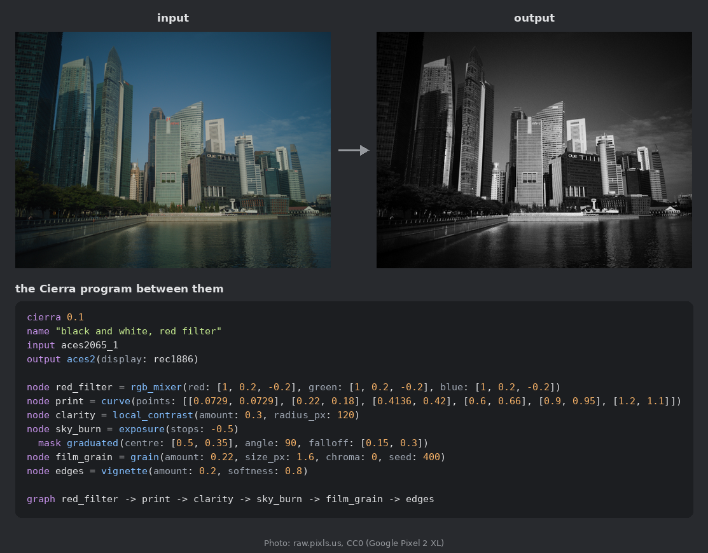
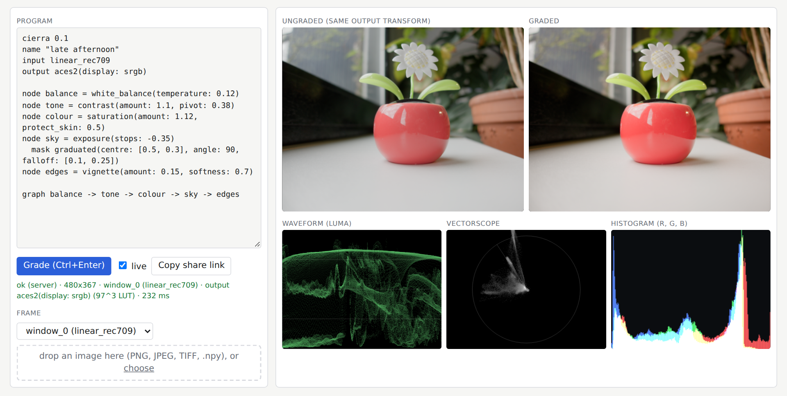
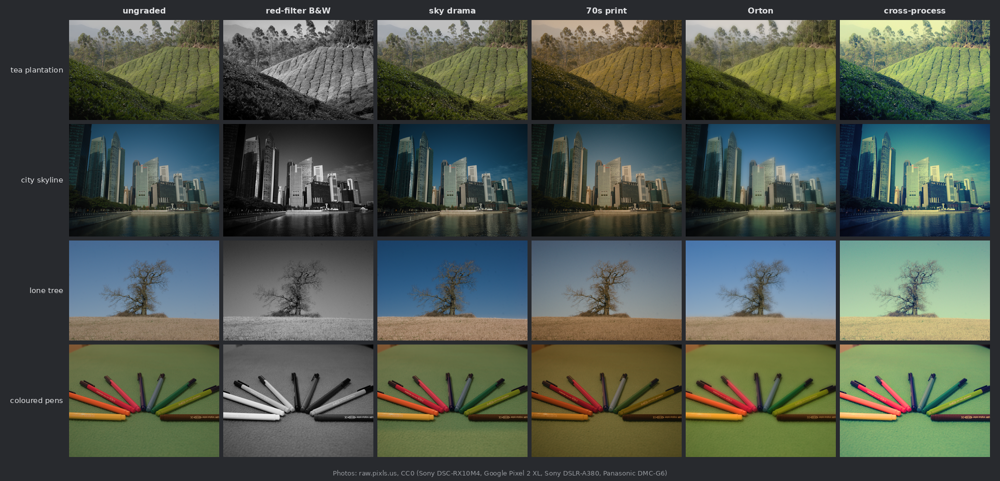
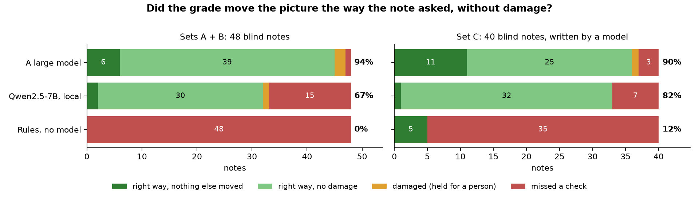

# Cierra: the longer guide

The short version is the [README](../README.md). This page keeps the details.

Cierra is a small language for colour grades. A grade is a plain text file that lists nodes and masks and how they
connect, so it can live in git next to everything else. Cierra checks the file, renders it, and compiles it to DCTL,
3D LUTs (.cube and CLF), ASC CDL, a CUDA kernel or a WebGPU shader.

We started it because we wanted our grading notes to end up as something we could check and keep, not as settings
inside one application's project. The NumPy renderer is the reference: every compiler is tested against it, and
when a target can't hold an op, the compiler refuses and names the node rather than approximating it.

The other half is grading from written notes with a language model. The model returns Cierra source and gets
measurements back, never pixels, and its program is checked like anyone else's.



The program under the pictures is [examples/bw_red_filter.cierra](../examples/bw_red_filter.cierra), with its comments
left out. It makes a black and white image mostly from the red channel, so the blue sky goes dark, then adds a hard
print curve, some clarity, a burned-in sky, grain and a vignette.

**At a glance**

- **A grade is a text file.** Nodes, masks and how they connect: readable, diffable, kept in git.
- **One reference, many targets.** The NumPy engine is the reference; DCTL, LUT (.cube / CLF), ASC CDL, CUDA and
  WebGPU are compiled from the same file and tested against it. What a target can't hold is refused by name, never
  approximated.
- **Grading from notes, measured.** A language model writes the program from your notes and the frame's numbers,
  never the pixels. Every note becomes a measurement, and a grade that clips, crushes or bands is held back.
- **Try it in a browser.** The [playground](#playground) grades a frame live on WebGPU, with scopes.

**Contents:** [Quick start](#quick-start) · [Playground](#playground) · [Examples](#examples) ·
[The language](#the-language) · [Rendering](#rendering) · [Compiling](#compiling) ·
[Grading from notes](#grading-from-notes) · [Status](#status) · [Licence](#licence)

## Quick start

You need Python 3.12 or later. `make` and a C/C++ compiler are optional; without gcc and g++ the DCTL and CUDA
parity tests skip.

```
git clone https://github.com/EzulFilm/cierra && cd cierra
python3 -m venv .venv && . .venv/bin/activate
pip install -e ".[images]"        # Pillow and tifffile, for PNG / JPEG / TIFF
```

On Debian and Ubuntu, `venv` comes from the `python3-venv` package. `make setup` does the same install with pinned
versions. Run everything from the repository root with the environment active (`. .venv/bin/activate` in each new
shell); `cierra --help` and `cierra COMMAND --help` list the options. Save this as `hello.cierra`:

```
cierra 0.1
name "hello"
input linear_rec709
output aces2(display: srgb)

node warm = printer_lights(red: 2, blue: -2)
node pop = cdl(slope: [1.05, 1.05, 1.05], sat: 1.1)
node crisp = sharpen(amount: 0.4)

graph warm -> pop -> crisp
```

Then:

```
cierra check hello.cierra                                     # prints the canonical form
mkdir -p out                                                  # render won't create the folder
cierra render hello.cierra tests/data/frames/pens.npy out/pens.png
cierra dctl hello.cierra out/hello                            # -> out/hello/hello.dctl
cierra lut hello.cierra out/hello                             # refused
```

The last one fails on purpose. `sharpen()` looks at neighbouring pixels and a LUT can't, so `lut` exits with an error
naming the node. Delete the `crisp` line, change the graph to `warm -> pop`, and the same file compiles to a LUT with
`cierra lut hello.cierra out/hello_lut` and folds into one CDL with `cierra cdl hello.cierra out/hello_cdl`.

When the checker finds problems it reports all of them, with line and column. Nothing is installed into a grading
application; you load the `.dctl`, `.cube`/`.clf` or CDL file yourself.

`make test` runs the whole suite in a few minutes, with no network, GPU, API key or model. `make test-fast` covers
the language, checker and engine in seconds. `make build` compiles every look in `looks/` to each target that can
hold it, into `out/build/`.

## Playground



Paste a program, pick or drop a frame, and the grade runs in your browser: the program's own WebGPU shader, then its
output transform, then the scopes. It regrades as you type, and "Copy share link" puts the program in the URL.

```
python tools/playground_server.py              # then open http://127.0.0.1:8790/
```

It needs a browser with WebGPU (Chrome or Edge 113+, Safari 26, Firefox 141+). Programs with spatial ops are refused
with the WebGPU target's own reason. Measured in headless Chromium on the chart frames, the shader is within
0.003 ΔE00 of the reference engine and what's on screen within 0.36 (the ACES 2.0 output is a 97³ LUT there).

There is also a build with no server: `python tools/build_playground_static.py` writes a plain folder (about 36 MB)
that any static host can serve. In it Cierra's own compiler runs in the browser through Pyodide, and it reads PNG
and JPEG. Camera-log files and `photo_to_scene` still need the local server, and the page says so.

## Examples



The columns are [red-filter B&W](../examples/bw_red_filter.cierra), [sky drama](../examples/sky_drama.cierra),
[70s print](../examples/warm_70s_print.cierra), [Orton](../examples/orton_landscape.cierra) and
[cross-process](../examples/cross_process_video.cierra). [examples/](../examples/) has 22 commented programs for ordinary
jobs (skin, bleach bypass, day for night, an HDR deliverable, a tungsten fix, ...) and [looks/](../looks/) has three
longer ones. The photos are CC0 camera RAWs from raw.pixls.us; `python tools/make_readme_figures.py` downloads them
(checked by SHA-256) and rebuilds the figures. It needs rawpy.

## The language

[docs/authoring.md](authoring.md) lists the 33 ops and 10 masks with their parameters and defaults, and
[docs/spec.md](spec.md) is the specification. Most of the ops are what you'd find on a grading panel (wheels,
CDL, curves, hue curves, mixers); some are spatial, like blur, glow, halation, local contrast and noise reduction.
Masks combine with `and`, `or` and `not`, values can be keyframed, and branches can be blended back together.

The checker enforces every parameter's unit and range and caps the size of a program. That's what makes it safe to
render a model's output without trusting the model.

## Rendering

`cierra render PROGRAM IMAGE OUT.png` (or `.tif`) runs the reference engine, in float64 NumPy on the CPU. With an
NVIDIA GPU, `pip install -e ".[cuda]"` and `cierra --device gpu render ...` run the same code there, and the tests
compare the two.

It reads `.npy`, PNG, JPEG and TIFF, and single frames of video with `--frame N` (ffmpeg and ffprobe have to be on
PATH). Image files are read as full range unless you pass `--range video`. The program's
`input` line says what the pixels are: a camera log encoding (LogC, S-Log3, V-Log, Apple Log and others), a
display-referred photo, or scene-linear. Output goes through ACES 2.0 for SDR, P3 or HDR (PQ and HLG).

`cierra track look.cierra clip.mov --node face --from 0 --to 120` makes the window, box or graduated mask on node
`face` follow the picture, and writes the motion into the program as keyframes. If the track is lost, it stops and
names the frame, and nothing is written.

`temporal_denoise` needs `requires frames` in the program and a clip to render from; it averages each pixel with
neighbouring frames where they match, after undoing a pan (to 1/8 pixel). Like the other temporal work, it only
runs in the reference engine. `cierra scopes clip.mov --from 0 --to 120 --step 5` prints numeric scopes per frame
(tone, waveform, vectorscope, skin, clipping) and the flicker across them, as JSON.

To grade camera RAW stills into a movie, `pip install -e ".[raw]"` and run
`python tools/raw_to_video.py my_look.cierra shot_*.dng --out shot.mov` (one RAW file per frame; ffmpeg needed).
`make pipeline-demo` does this with a CC0 example. Cinema RAW formats need converting to DNG or EXR first.

## Compiling

All targets work on ACEScct values.

| Command | Writes | Holds |
|---|---|---|
| `cierra dctl` | `.dctl` | pointwise ops, grain, vignette; masks other than depth, segment and blurred or feathered ones; one spatial op per file (below); keyframes at one frame (`--frame`) |
| `cierra lut` | `.cube` and CLF | pointwise ops without keyframes |
| `cierra cdl` | ASC CDL | a serial chain of `printer_lights`, `contrast`, `cdl` and `saturation`, without masks or keyframes, folded into one CDL |
| `cierra cuda` | a CUDA kernel | what DCTL holds, minus the spatial ops (tested through a CPU harness so far) |
| `cierra wgsl` | a WebGPU shader | as CUDA (the tests skip without a GPU adapter; the playground runs it) |

Spatial ops in a DCTL: one blur, sharpen, glow, halation or diffusion per file, with a radius up to 12 px (at the
program's `reference_width`, default 1920). A wide sharpen, local contrast or highlights / shadows compiles to a pair
of files for two consecutive nodes: the first writes a horizontal luma blur to alpha and the second reads it. The
pair is checked through a CPU harness, not yet inside a grading application.

For a Rec.709 project without colour management, `cierra dctl look.cierra out --in KIND` makes a DCTL that decodes
the input (a camera log or display video), grades, and encodes for the display. Keep the `.cube` it writes next to
the `.dctl`: it holds the ACES 2.0 output (97³, within 0.5 ΔE00 on the looks tested).

If a target can't hold part of the graph, `--split` writes the parts it can and names what's left out. Here the
local contrast now fits as a pair of DCTLs, so nothing is left out:

```
$ cierra dctl examples/bw_red_filter.cierra out/split --split
wrote out/split/bw_red_filter_main_horizontal.dctl - G5 B horizontal luma Gaussian in alpha; put the vertical pass on the next node
wrote out/split/bw_red_filter_main_vertical.dctl - G5 B vertical alpha Gaussian and luma op; put immediately after the horizontal pass
```

The measured differences between each target and the engine are in [docs/targets.json](targets.json)
(`make targets` regenerates it), and section 11 of the spec says exactly what each target covers.

`cierra import-lut grade.cube imported.cierra` fits a program to an existing 3D LUT and prints how far it is from
the LUT in ΔE00 (`--input` says what the LUT expects, if it isn't ACEScct). A LUT only maps colours, so blur, grain
and windows can't come back out of it. `cierra fit image reference fitted.cierra` does the same from a pair of
images, an ungraded one and a graded reference of the same size.

For ACES pipelines, `cierra amf look.cierra out/amf` writes the look as a CLF in ACES2065-1 and an ACES Metadata
File (AMF v2.0) that names the camera's input transform (`--in KIND` to name another camera), the look file with its
hash, and the ACES 2.0 output. The files validate against the Academy's schema and read back through OpenColorIO.

ACES and AMF are specifications of the Academy of Motion Picture Arts and Sciences. Cierra is not affiliated with or
endorsed by the Academy.

## Grading from notes

```
$ cierra loop "warmer faces, a little more contrast, keep the blacks clean" tests/data/frames/crowd.npy history/
iteration 1: v1 4c311f3abb26 notes met 4/4
iteration 1: every note is met; stopping
```

What happens in a run:

1. The notes become checks ("warmer faces" is the warmth of the skin region, and nothing else getting warmer).
2. A driver writes a program: a fixed set of rules, a local model, or a hosted one. It sees the notes and numbers
   about the frame, never pixels.
3. A deterministic tuner sets the values until the checks are met. It refuses any step that adds damage: clipped
   highlights, crushed or milky blacks, banding.
4. Each candidate and its diff go to `history/`, with how each note moved against the ungraded frame and anything
   that moved when no note asked for it. A damaged candidate can't finish the run; it is held for a person.



The chart is the question that matters, asked of three drivers: did the grade move the picture the way the note
asked, on every point, without damage? The notes are free-form ("make it feel like a late-autumn evening"), the
checks behind them are hidden from the driver, and the frames are the CC0 test photos. Read it with care: 88 notes,
one run each; the checks are simple measures tuned on the test frames, not validated with viewers; and the second
set, written by a model, turned out easier than the first. `tools/bench_notes.py` scores any run, and
`tools/make_readme_charts.py` redraws the chart.

Choosing the driver:

| Driver | How |
|---|---|
| Rules (the default, and what produced the run above) | nothing to configure |
| A local model | `CIERRA_LLM_URL` set to an OpenAI-compatible server |
| The Anthropic API | `ANTHROPIC_API_KEY`, after `pip install -e ".[llm]"` |
| A person or a chat answering through files | `CIERRA_DRIVER=relay` and `CIERRA_RELAY_DIR` |

`CIERRA_DRIVER` forces one. When a run reaches `CIERRA_BUDGET_USD` (default 2.00), it finishes with the rules
driver. The model choice and the other settings are described at the top of [cierra/llm.py](../cierra/llm.py). Nothing
the model writes is executed, and keys are read only from the environment. `loop` takes `--frame` and `--range`
like `render`.

To run a model locally (a pinned llama.cpp CPU build and Qwen2.5-7B-Instruct Q4_K_M, about 4.7 GB, SHA-256
checked):

```
make llm-setup      # needs git, cmake, a C++ compiler and curl
make llm-start      # serves on 127.0.0.1:8090
make eval-llm       # the held-out evaluations; tens of minutes on a CPU
make llm-stop
```

Cierra doesn't ship any weights. `make eval` scores the rules driver on held-out notes. We still compare
runs by eye with `tools/eval_sheet.py`; the checks don't judge the look.

### Into a grading application

`cierra/assist.py` is the checked route for an assistant: it takes a program and the notes, runs the checker, the
damage gate and the note checks, compiles the DCTL, runs that DCTL on the frame against the engine before anything
leaves, and writes a package with the hashes of every file. When the application's own stills come back, it compares
them with the engine and measures the notes again on those pixels: "verified", "contradiction" or "unverified".
So far the application side has been tested with a simulated host only.

`cierra/hosts/grading_app.py` connects to a grading application through its scripting API with a few fixed scripts
that take JSON. It can put a program on a clip node for node, in a new colour version that's rolled back if
a step fails, and read a grade back as a LUT for `import-lut`. The API can't create nodes, so the clip needs enough
serial nodes already, and it can't read wheel, curve or qualifier values, which is why the grade comes back as a
LUT.

## Status

This is version 0.1 of the language, and the spec may still change before 1.0. [CHANGELOG.md](../CHANGELOG.md) records
what changed. Contributions are welcome, see [CONTRIBUTING.md](../CONTRIBUTING.md); security reports go to
[SECURITY.md](../SECURITY.md).

## Licence

Copyright 2026 CIERRAEZUL LLC. Apache License 2.0 ([LICENSE](../LICENSE)); see [NOTICE](../NOTICE). "Cierra" is a name used
by CIERRAEZUL LLC and is not licensed under the Apache License. The test frames and README figures are made from CC0
camera RAW photos (raw.pixls.us) and a synthetic chart (tests/data/SOURCES.md).
